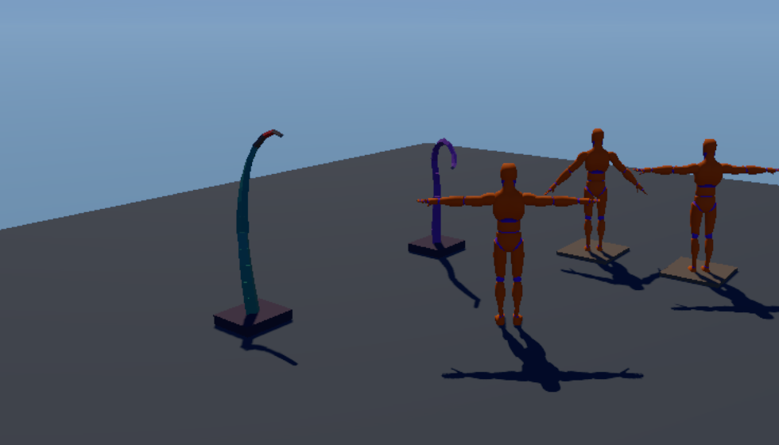

# Animation demo

The engine's animation tools side by side on one floor:

- **A mannequin you steer** while it keeps facing the way the camera
  looks. One 2D blend space (`kke::BlendSpace2D`) over idle, a walk in
  eight directions and a forward jog picks the clips from its velocity
  in its own frame; the panel shows each clip's weight live.
- **Two copies of it modelled in an A-pose** (arms 45 degrees down)
  that copy its pose every frame (`kke::PoseRetarget`). The left one has
  rest matching off: its arms stay 45 degrees low in every pose. The
  right one has it on: it moves exactly like the mannequin.
- **Two tentacles** that reach for the mannequin's head when it comes
  near, and sway about when it doesn't: FABRIK (green, no limits) and CCD
  with a bend limit per joint and damping (purple). Joints bent past the
  limit turn red.



Start here for characters that strafe and back off while aiming,
characters from other packs playing your clips, or tails, tentacles and
other long chains that must bend like a body does. The engine side is in
[docs/MOVEMENT.md](../../docs/MOVEMENT.md) (blend spaces, retargeting)
and [docs/PROCEDURAL_ANIMATION.md](../../docs/PROCEDURAL_ANIMATION.md)
(FABRIK and CCD).

## Run it

The executable is `anim_demo` (`kke_add_game(anim_demo ...)` in
[CMakeLists.txt](CMakeLists.txt)). The mannequin and its clips come from
the Universal Animation Library (Quaternius, CC0):
`assets/animations/UAL1_Standard.fbx`, and `UAL2.fbx` beside it (or the
"Universal Animation Library 2" pack) for the eight-way walk. Without
UAL2 the mannequin turns to walk forward; without UAL1 only the
tentacles play (the panel says so).

```bash
cmake --build build --target anim_demo
cd build/bin
./anim_demo
KKE_ANIM_REST=1 ./anim_demo                       # everyone in the clips' rest pose
KKE_ANIM_MOVE=0,1 KKE_ANIM_CIRCLE=8 ./anim_demo   # walk in circles by itself
```

| Variable | Effect |
|---|---|
| `KKE_ANIM_MOVE=x,y` | hold the move stick there (x right, y forward, -1 to 1): for checks without a controller |
| `KKE_ANIM_CIRCLE=<s>` | turn that stick round once every `<s>` seconds, through every direction of the blend space |
| `KKE_ANIM_REST=1` | start with "Show the rest pose" on |
| `KKE_ANIM_MIRROR=1` | start with the polished floor (with `KKE_REFLECTIONS=screen`, `kke` or `classic` it reflects the scene) |
| `KKE_ANIM_GLASS=1` | start with the glass block in front of the tentacles (with reflections on it bends what is behind it; `KKE_REFRACTIONS=0` to compare) |
| `KKE_ANIM_LIGHTS=n` | start with n small coloured lamps over the floor, the many lights past the 16 key ones (clustered; `KKE_CLUSTERS=0` walks them all, to compare; try `KKE_MOOD=night`) |
| `KKE_ANIM_VIEW=d,p,y` | start the camera `d` metres away at pitch `p` and yaw `y` (radians) |
| `KKE_ANIMATIONS_DIR=<folder>` | where to look for `UAL1_Standard.fbx` and `UAL2.fbx` |
| `KKE_SKIP_INTRO=1` | skip the logo intro (engine-wide) |

## Controls

| Action | Keyboard / mouse | Controller |
|---|---|---|
| Move (the mannequin faces the camera's way) | WASD | left stick |
| Walk instead of run | the walk key of the character controls | the walk button |
| Turn the camera | left-drag | right stick |
| Zoom | wheel | d-pad |
| Settings panel | F3, or click | View |

Rebindings are saved to `anim_demo_input.json`. The panel has the live
blend weights, "Show the rest pose", and the tentacles' bend limit
(8 to 60 degrees a joint) and damping (1 to 30 degrees a pass).

## How it works

[AnimDemoModule.cpp](AnimDemoModule.cpp):

- `loadCharacters()` loads UAL1, adds UAL2's clips to the same skeleton
  (`kke::appendClipsByBoneName`), and spawns the mannequin. `aPoseOf()`
  makes the A-pose copies: the same model with each upper arm turned 45
  degrees down at rest. The skin keeps its T-pose binding, so drawn at
  rest the arms hang down, as an A-pose character's do. Two
  `kke::PoseRetarget`s copy the mannequin onto it, `matchRest` off and on.
- `buildBlendSpace()` lays the clips out by velocity in the character's
  own frame (x = right, y = forward, m/s): idle at the middle, the walk
  round it at 1.5 m/s every 45 degrees, the jog at 3.5 m/s ahead. The
  gradient band weights (polar: direction as an angle, speed as a
  length) change smoothly as the stick turns, so there is no pop
  between "strafe left" and "walk forward", and all weighted clips play
  at one shared phase so the feet never slide.
- `steer()` turns the stick into a velocity relative to the camera
  (running only ahead, walking sideways and back, the clips UAL has) and
  gives the blend space that velocity in the mannequin's frame.
- `reach()` runs `kke::fabrikPoints` on one tentacle and
  `kke::ccdPoints` with `maxBendDegrees` and `maxStepDegrees` on the
  other, and measures the sharpest bend of each the same way.

## Make a game like this

A character that strafes while aiming (goblin_horde's heroes do this):

```cpp
kke::BlendSpace2D space;
space.points = { { idle, { 0, 0 } }, { walkFwd, { 0, 1.5f } }, { walkLeft, { -1.5f, 0 } },
                 { walkRight, { 1.5f, 0 } }, { walkBack, { 0, -1.5f } } };
const int move = animator.addBlendState2D("move", space);
animator.play(move);
// every frame: the velocity in the character's frame
animator.setParameter2(glm::vec2(glm::dot(v, right), glm::dot(v, facing)));
```

A character from another pack playing your clips, whatever its rest
pose: `kke::retargetAnimations(ual, character, kke::matchBones(ual, character))`
(rest matching is on by default). A tail or tentacle: keep its joints
as points and call `kke::ccdPoints(points, target, settings)` each
frame, with a bend limit per joint.

## Files

| File | What |
|---|---|
| [main.cpp](main.cpp) | the modules: input, UI, audio, orbit camera, models, the demo, its panel |
| [AnimDemoModule.h](AnimDemoModule.h) / [.cpp](AnimDemoModule.cpp) | the demo |
| [game.json](game.json) | the marketplace entry |
| `engine/include/kke/Animator.h` | `BlendSpace2D`, `Animator::addBlendState2D` |
| `engine/include/kke/AnimRig.h` | `PoseRetarget`, `retargetAnimations`, rest matching |
| `engine/include/kke/ProceduralAnim.h` | `fabrikPoints`, `ccdPoints`, `CcdSettings` |
