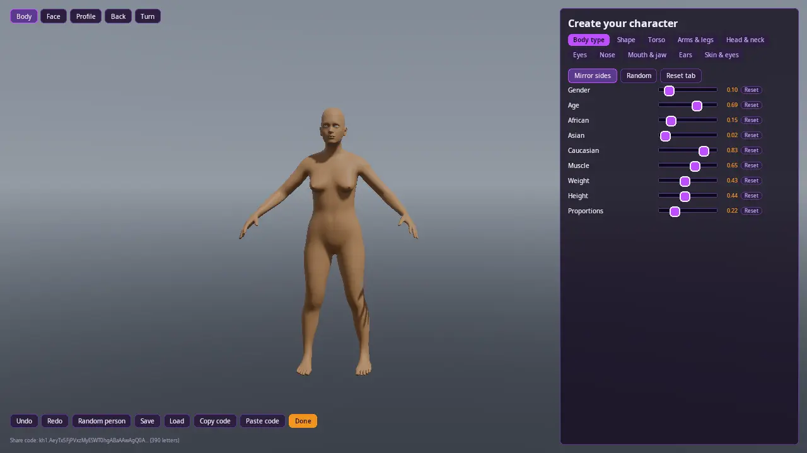
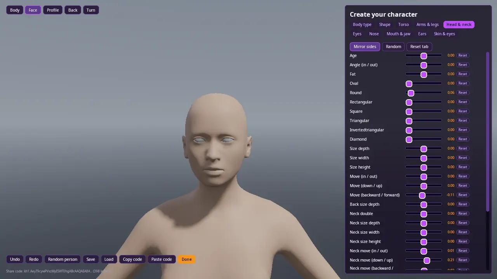
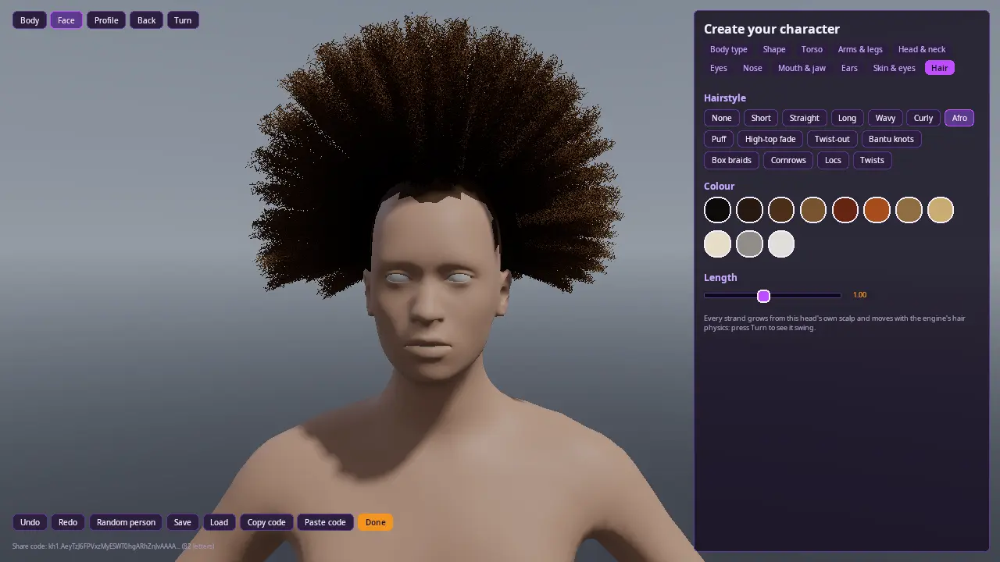
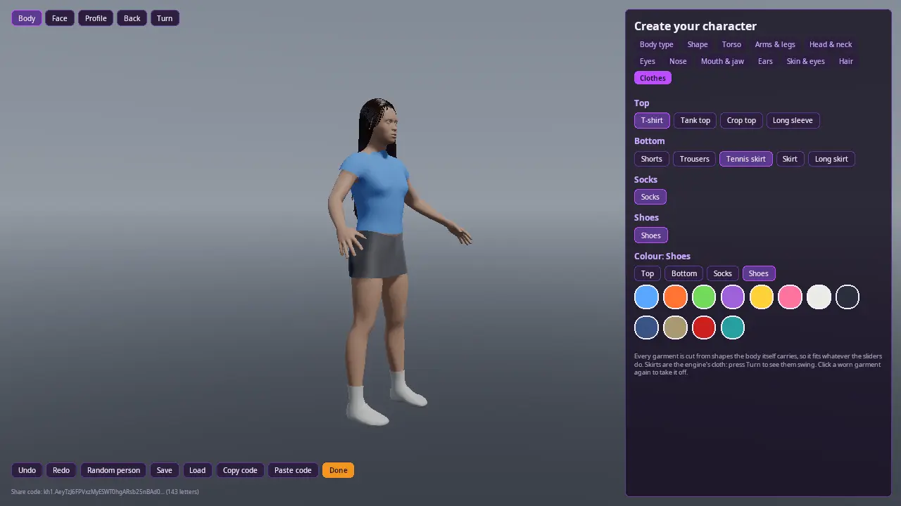

# Character creator

Make a realistic person with sliders: body type (gender, age, ancestry,
muscle, weight, height, proportions), then the shape of the torso, arms
and legs, head and neck, eyes, nose, mouth, jaw and ears, about 300
sliders in all, a skin tone, and hair: 14 hairstyles from short and long
to an afro, box braids, cornrows and locs, 11 colours and a length, as
real strands grown from this head's own scalp and moved by the engine's
hair physics, and clothes: four tops, shorts, trousers, three skirts,
socks and shoes in 12 colours, fitted to any body, the skirts swinging as
the engine's cloth. The person is MakeHuman's CC0 human
(docs/HUMANS.md), so every slider is a morph sculpted by artists, and the
sliders blend the way MakeHuman's do.

The screen is `kke::CharacterCreatorModule`, an engine module, not code
that lives in this demo: a tennis game, a dress-up game or an RPG adds the
same module, hears `onDone`, and gets the finished person. This demo is
that module and nothing else.

Run it: `cd build/bin && ./character_creator`.

| Do | How |
| --- | --- |
| Move a slider | Drag it |
| Turn the camera | Left drag beside the panel, or a controller's right stick |
| Views | Body, Face, Profile, Back |
| See the hair and skirts move | Turn: the figure spins, its hair and skirt swing out |
| Wear something | Clothes tab: click a garment (again to take it off), then a colour |
| Both sides at once | Mirror sides (on by default) |

Moving the sliders with a controller is not in yet.

**Body types** on the Body type tab (Slim, Athletic, Strong, Curvy,
Heavy, Average) set the build sliders at once for the current gender;
the face, age and ancestry stay. **Random** randomises the tab you are on,
**Random person** everything, and half the time starts from a body type.
A random person stays believable: a third of the detail sliders move, and
only a little, because many sliders far out at once make a face nobody
has. **Undo** and **Redo** go back up to 100 steps (one step per drag).
**Save** and **Load** use `character.kkhuman` in the game's save folder.
**Copy code** puts the share code on the clipboard and **Paste code**
reads one.

## How it is built

- **One bake, then only vertices move.** The body is baked once into an
  ordinary model. While a slider moves, `Human::reshape` moves the same
  vertices and `ModelModule::setDeformedVertices` uploads them: no new
  model, no new GPU buffers. `bakeSkinned()` gives a game the finished
  body with bones and weights for the engine's GPU skinning, so in the
  game a custom person costs what any skinned model costs.
- **Multiplayer: values travel, not meshes.** A look is slider values and
  colours. `shareCode()` packs them into a URL-safe string (`kh1.`...),
  about 90 letters for a few changes and 250 for a random person; the
  other machines load the same pack and bake the same body. The player's
  own body uses `quantised()` values, rounded exactly like the code, so
  everyone sees the same vertices. A code made with another pack is
  refused, not misread.
- **Hair** is the engine's strand hair (docs/HAIR.md) grown from the
  body's scalp by `kke::hairOnHuman` (docs/HUMANS.md "Hair"), simulated
  in a `RigidWorld` where the body is a mesh only hair and cloth feel.
  The scalp is painted the hair's root colour. 160 guide strands, a few
  thousand drawn hairs built on the GPU.
- **Clothes** are cut from shapes MakeHuman's body carries, a body suit
  and a long skirt (docs/HUMANS.md "Clothes"), so they fit every body the
  sliders make. Fitted garments are models that move with the body's
  vertices; skirts are the engine's cloth pinned at the waist. Over the
  network a garment is its name and colour. `bakeSkinned()` hands the
  game the person dressed, every garment skinned to the body's bones.
- **Saves** are JSON (`kk-human`, version 1) with MakeHuman's slider
  names, and `lookFromMhm` reads `.mhm` files from the MakeHuman app.
- **The screen** is RmlUi: `assets/ui/character_creator/creator.rml` and
  `creator.rcss`. Run with `KKE_CREATOR_UI=<that folder>` to use your
  copy, and press F5 to reload the stylesheet while the demo runs.
  `kke_use_character_creator(TARGET)` in CMake copies them and the human
  pack next to a game.

For CI and screenshots: `KKE_CREATOR_TAB=nose`, `KKE_CREATOR_VIEW=face`,
`KKE_CREATOR_HAIR=afro` (a hairstyle, empty for none),
`KKE_CREATOR_CLOTHES=t-shirt,tennis skirt,shoes` (empty for none),
`KKE_CREATOR_GENDER=0` (female) or `1`, `KKE_CREATOR_PRESET=Curvy`, `KKE_CREATOR_TURN=1`
(start turning), and `KKE_CREATOR_SELFTEST=1`, which makes a random
person, sends it through a share code and back, and logs `creator
self-test passed` when the code comes back the same, the person stands on
the floor, its hairstyle is on its head and every garment is on its body.

## Not yet

The plan's next steps, in order: animation (MakeHuman's rig onto the
engine's canonical bone names), skin textures, eye colour and brows,
MakeHuman's textured `.mhclo` clothes, a credits screen for CC-BY assets, and facial
expressions (ENG-F25).
